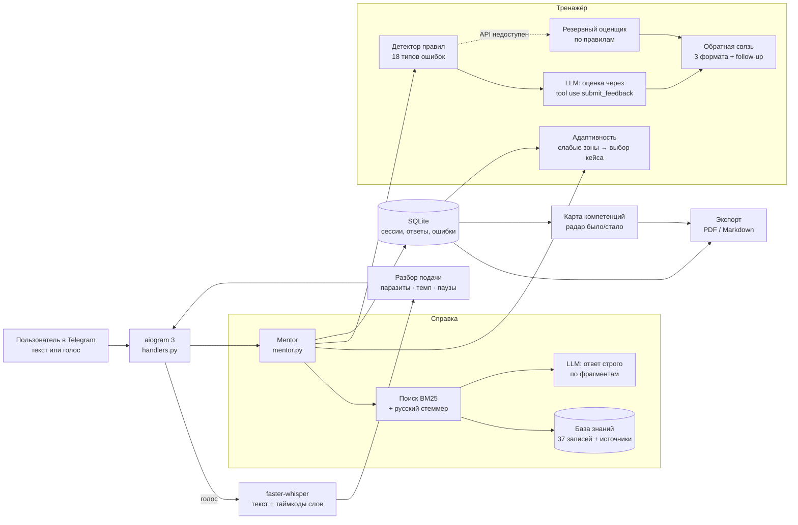

# Архитектура и стек «Компаса»

## Схема



## Поток в режиме «Справка»

1. Вопрос токенизируется и стеммится (Snowball, русский), стоп-слова отбрасываются.
2. BM25 ранжирует записи базы. Заголовок и теги весят вдвое больше текста, записи выбранного сценария получают приоритет.
3. Если ничего не найдено, бот честно говорит, что в базе ответа нет, и не выдумывает.
4. Топ-4 фрагмента передаются модели с жёстким правилом: факты только из фрагментов и ссылка `[ID]` после каждого факта.
5. Источники к ответу добавляет **сам бот** по процитированным ID, а не модель. Поэтому ссылки не могут быть выдуманы.

## Поток в режиме «Тренажёр»

1. **Выбор кейса.** `adaptive.pick_case` складывает веса слабых зон, которые проверяет кейс, откладывает недавно пройденные кейсы и продвигает редко пройденные.
2. **Детектор правил.** Регулярные выражения с силой сигнала. «Сильные» маркеры («ничего не умею», «вопросов нет») засчитываются всегда, «слабые», только если кейс проверяет эту ошибку.
3. **Оценка моделью.** Модель получает кейс, ключевые пункты сильного ответа, фрагменты базы, сигналы правил и слабые зоны пользователя. Результат возвращается через принудительный вызов инструмента `submit_feedback` со схемой (`score`, `correct`, `improve`, `improved_answer`, `errors`, `kb_refs`, `follow_up`), поэтому свободный текст парсить не нужно. Коды ошибок и ID источников ограничены перечислениями (`enum`).
4. **Слияние.** Сильные сигналы правил добавляются к итогу, даже если модель их пропустила.
5. **Сохранение.** Попытка и найденные ошибки пишутся в SQLite.
6. **Уточняющий вопрос.** Модель задаёт неудобный вопрос по слабому месту ответа или по слабой зоне из прошлых сессий. Глубина цепочки, до 2 уточнений.

## Адаптивное обучение (этап 4)

Вес слабой зоны:

```
weight(code) = Σ 0.5^(возраст_дней/7)              , по попыткам с этой ошибкой
             − 0.5 · Σ 0.5^(возраст_дней/7)         , по «чистым» попыткам в кейсах, которые её проверяют
```

Зоны с весом от 0,3 считаются активными. В начале новой сессии бот говорит: «В прошлый раз ты спотыкался на …, давай проверим ещё раз», и даёт кейс, который проверяет эту зону. Слабые зоны и рекомендации попадают в экспорт.

## Разбор подачи (голос)

1. faster-whisper распознаёт голосовое локально с `word_timestamps=True`. Подсказка `initial_prompt` с запинками («ну, э-э, типа…») не даёт модели «вычистить» паразитов из расшифровки.
2. `speech.analyze` считает:
   * паразитов: «жёсткие» («ну», «типа», «короче», «как бы», «в общем», «э-э»), всегда, «мягкие» («вот», «значит», «то есть», «на самом деле»), только при повторе 2 и более раз; «э-э-э», одна запинка;
   * темп = слова / (конец последнего слова − начало первого) × 60;
   * паузы между словами от 2,5 с, самую длинную паузу, задержку перед первым словом.
3. Оценка подачи, от 10 со штрафами: темп вне 90-170 слов/мин (ориентир из записи B14 базы), плотность паразитов (2, 6 и 15 на 100 слов), длинные паузы, старт позже 3 с. К разбору добавляются 1-3 конкретных совета и сравнение с прошлой голосовой попыткой.

## Карта компетенций

Шесть осей, группы кодов ошибок, седьмая, подача. Ось оценивается только по попыткам, где кейс проверял её ошибки:

```
ось = 0.5 · 10 · (1 − доля попыток с ошибкой из группы) + 0.5 · средняя оценка этих попыток
```

«Сейчас», текущая сессия (в прогрессе, последние 6 ответов), «раньше», всё до неё. Оси без данных не рисуются, чтобы ноль не выглядел как провал. Палитра проверена валидатором на различимость при дальтонизме (ΔE 24.7) и контраст.

## Надёжность

* Резервный режим без модели: справка показывает фрагменты базы, тренажёр оценивает по покрытию ключевых пунктов, найденным ошибкам и близости к эталону.
* Ретраи и таймаут запросов к API, prompt caching для статичной части промпта.
* Тесты: `tests/test_core.py` проверяет поиск, детектор, адаптивность, хранилище и экспорт. `tests/test_bot_flow.py` прогоняет сквозной Telegram-сценарий с заглушкой HTTP-сессии бота: старт → справка → кейс → разбор → уточнение → следующий кейс → итог → прогресс → адаптивный выбор → PDF → удаление данных.

## Приватность

Хранится только Telegram `user_id` без имени и username, плюс история тренировок. Голос распознаётся локально и сразу удаляется. `/forget` полностью удаляет данные пользователя.

## Стек

| Слой | Технология |
|---|---|
| Бот | Python 3.10+, aiogram 3 (FSM, inline- и reply-клавиатуры) |
| Языковая модель | Anthropic API (Claude), tool use для структурированного вывода, prompt caching |
| Поиск | собственная реализация BM25, Snowball-стеммер |
| Данные | SQLite через aiosqlite; база знаний, кейсы и ошибки, JSON |
| Голос | faster-whisper (локально, CPU, int8) |
| Экспорт | fpdf2 (PDF с кириллицей, шрифт DejaVu), Markdown |
| Графика | matplotlib (карта компетенций) |
| Деплой | systemd на VPS |
